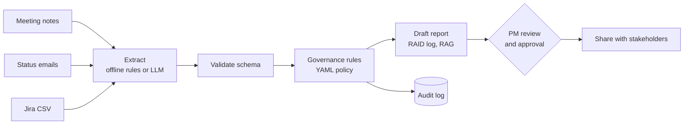

# Delivery Governance Copilot

[](https://github.com/<your-username>/delivery-governance-copilot/actions)


**Turns the messy inputs of real delivery (meeting notes, status emails, Jira exports) into governed, auditable outputs: a unified RAID log, rule-based governance findings, a RAG status and a draft weekly report. A project manager approves everything before it goes anywhere.**

Built by a delivery lead, for delivery leads. It automates the clerical 80% of governance so the PM can spend time on the judgement 20%.

> All sample data is fictional ("Project Atlas"). No client data is used anywhere in this repo.

## The problem

On concurrent enterprise projects, governance information is scattered: actions in meeting notes, risks buried in vendor emails, status in Jira. Consolidating it by hand every week is slow, inconsistent, and the first thing to slip when delivery gets busy. Typical symptoms: actions with no owner, overdue items nobody escalated, scope changes agreed in conversation with no change request.

## What it does

| Stage | What happens |
|---|---|
| **Ingest** | Reads meeting notes (`.md`), emails (`.txt`) and Jira CSV exports |
| **Extract** | Pulls Risks, Assumptions, Issues, Dependencies, Actions and Decisions with owner, due date and severity. Offline rules by default; optional LLM mode |
| **Govern** | Runs 7 configurable governance rules (see below) |
| **Report** | RAG status, escalations, open RAID items, decisions, items needing human review |
| **Audit** | Append-only JSONL log with SHA-256 of every input and `human_approval: PENDING` |



### Governance rules (policy lives in `config/governance_rules.yaml`)

| ID | Rule | Default severity |
|---|---|---|
| GOV-001 | Open item has no accountable owner | Medium (High if item is High/Critical) |
| GOV-002 | Risk/Issue/Action/Dependency has no due date | Medium |
| GOV-003 | Overdue; escalates at 7+ days or for High/Critical items | Medium / High |
| GOV-004 | In-progress ticket untouched for 14+ days | Medium |
| GOV-005 | Blocked with no target unblock date | Medium / High |
| GOV-006 | Probable duplicate of an item from another source | Low |
| GOV-007 | Possible scope change with no change-request reference | High |

RAG: **Red** at 1+ critical or 3+ high findings; **Amber** at 1+ high or 4+ medium; otherwise **Green**. Thresholds are config, not code.

## Quick start

```bash
git clone https://github.com/<your-username>/delivery-governance-copilot.git
cd delivery-governance-copilot
python -m venv .venv && source .venv/bin/activate      # Windows: .venv\Scripts\activate
pip install -e ".[dev]"
dgc demo                                               # runs on the bundled fictional sample data
pytest -q
```

See a pre-generated result in [`examples/output/`](examples/output/weekly_status_report.md).

Run on your own files:

```bash
dgc run --project "My Project" --as-of 2026-11-04 \
  --notes notes/*.md --emails emails/*.txt --jira exports/jira.csv --out output
```

Notes use a light convention: lines starting with `Action:`, `Risk:`, `Issue:`, `Dependency:`, `Decision:` or `Assumption:`. Owner and due date are inferred from phrases like `Marcus to ... by Fri`, `owner: Sofia`, `[high]`. Emails are also scanned for sentences that look like issues, risks and dependencies (flagged low-confidence for review).

### Optional LLM mode

```bash
pip install -e ".[llm]"
export ANTHROPIC_API_KEY=...          # see .env.example
dgc run --mode llm ...
```

LLM mode is an enhancement, not a dependency. Emails and phone numbers are redacted before text leaves the machine, model output is validated against the same schema as offline extraction, and any failure falls back to offline extraction and is recorded in the audit log.

## Design principles

1. **Human in the loop.** Every output is stamped DRAFT. The tool recommends; the PM decides. ([ADR-0001](docs/adr/0001-human-in-the-loop.md))
2. **Offline-first.** Works with no network or API key, so it is testable, demoable and safe for sensitive environments. ([ADR-0002](docs/adr/0002-offline-first-extractor.md))
3. **Policy as configuration.** Thresholds and rule toggles are in YAML so a governance lead can tune them without touching code. ([ADR-0003](docs/adr/0003-policy-as-config.md))
4. **Traceable.** Every item links to its source file; every run records input hashes.
5. **Distrust model output.** LLM responses are schema-validated and low-confidence items are surfaced for review.

## How this repo is run as a project

This repo follows the governance it automates: [project charter](docs/00-project-charter.md), [governance framework](docs/01-governance-framework.md), [RACI](docs/02-raci.md), its own [RAID log](docs/03-raid-log.md), [roadmap with milestones](docs/05-roadmap.md), architecture decision records, issue and PR templates, and CI on every change. Work is tracked in GitHub Issues and Milestones.

## Limitations (honest ones)

- Offline extraction is heuristic: it depends on the note-taking convention and will miss items written in free prose. That is why low-confidence items are listed for review.
- Date parsing handles common phrasings only (ISO, `6 Nov`, `Nov 6`, weekdays).
- Duplicate detection is fuzzy title matching, not semantic.
- No live Jira/Confluence integration yet (see roadmap). CSV export only.
- Not yet validated against real project data; the effectiveness targets in the charter are hypotheses to be measured, not results.

## Roadmap

See [docs/05-roadmap.md](docs/05-roadmap.md). Next: Jira Cloud API connector, Confluence publishing of approved reports, Power BI-ready dataset export, evaluation harness for extraction accuracy.

## Licence

MIT. See [LICENSE](LICENSE).
